# 📱 Nova

> **오픈 직후 신청이 몰려도 사전예약을 유실 없이 접수하고, 외부 시스템 처리를 기다리지 않고 결과를 안내하는 스마트폰 사전예약 플랫폼**
> 급증 트래픽 대응과 비동기 처리 신뢰성에 집중해 개발한 반응형 웹 서비스입니다.

🔗 **서비스**: https://www.grandis-nova.link

---

## 🌟 프로젝트 개요

- **서비스명**: **Nova**
- **타겟**: 신규 스마트폰 출시 직후 사전예약을 신청하려는 고객과, 그 접수 흐름을 지켜보고 장애를 고치는 운영자
- **기간**: 약 2개월
- **범위**: 고객용 쇼핑 화면 + 운영자용 관리자 콘솔. 외부 예약 시스템은 팀이 만든 Mock으로 대체

### 🔍 배경 및 문제 상황

- 오픈 직후 신청이 한꺼번에 몰림 — 목표 규모는 **10초에 5,000건**
- 예약을 확정하려면 외부 예약 시스템에 등록해야 하는데, **평균 500ms가 걸리고 5% 확률로 실패**
- 외부 호출을 요청 안에서 기다리면 줄이 멈추고, 서버가 중단되면 접수된 예약이 공중에 뜸
- 버튼 연타·네트워크 재전송으로 **한 사람이 두 자리를 차지**할 위험
- 우리 기록과 외부 기록이 어긋나도 **운영자가 알아차릴 방법이 없음**

### 🌈 핵심 가치

- **접수와 확정의 분리**: 접수는 순번만 끊어 주고 즉시 응답하고, 외부 등록은 백그라운드에서 처리 — 외부 시스템이 느리거나 죽어도 접수 경로는 독립적으로 동작
- **일시 실패 ≠ 최종 실패**: 자동 재시도로 복구하고, 재시도가 소진되면 운영자가 재처리해서 결국 확정까지 밀어붙임
- **운영자가 볼 수 있는 파이프라인**: 지금 어디서 막혀 있고 사람이 손댈 건 몇 건인지 한 화면에서 확인하고, 그 자리에서 고침

---

## 📸 화면

> 캡처는 MSW 목 서버(오픈 시나리오: 사전예약 3개에 5,000명이 몰리고 외부 등록 5% 실패)에서 찍었습니다. 숫자는 시뮬레이션 값입니다.

### 고객 — 사전예약부터 구매 확정까지

<table>
  <tr>
    <td width="50%"></td>
    <td width="50%">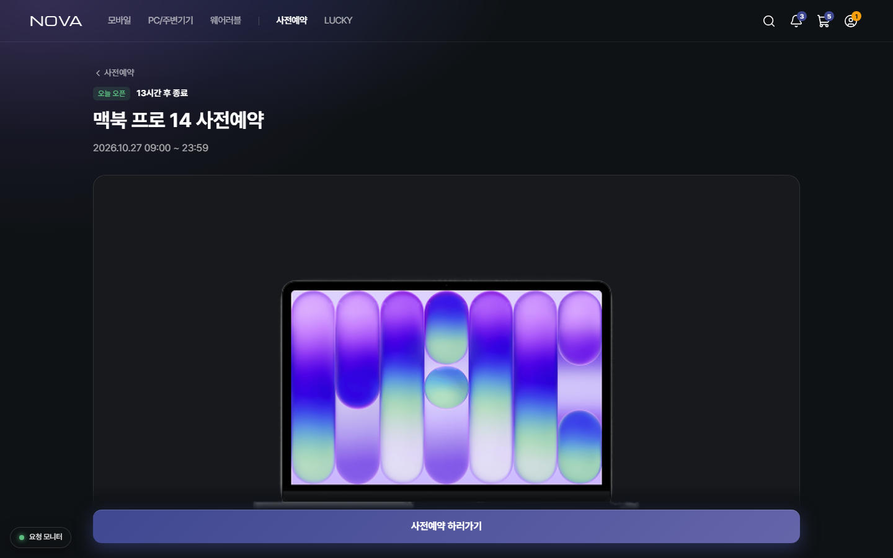</td>
  </tr>
  <tr>
    <td align="center"><b>메인</b> · 진행 중인 사전예약을 배너로</td>
    <td align="center"><b>사전예약 상세</b> · 일정과 모델</td>
  </tr>
  <tr>
    <td>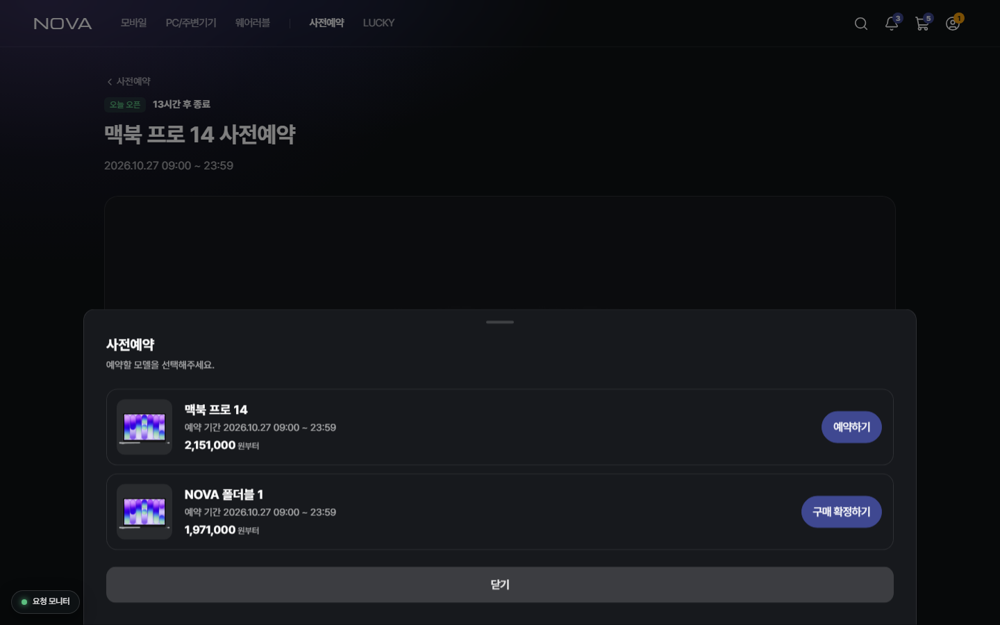</td>
    <td>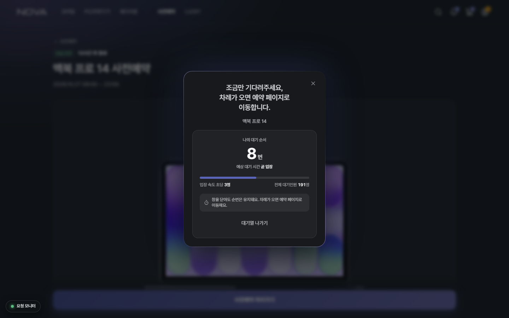</td>
  </tr>
  <tr>
    <td align="center"><b>모델 선택</b> · 이미 예약한 모델은 구매 확정으로</td>
    <td align="center"><b>대기열</b> · 내 순서와 예상 대기, 창을 닫아도 순번 유지</td>
  </tr>
  <tr>
    <td>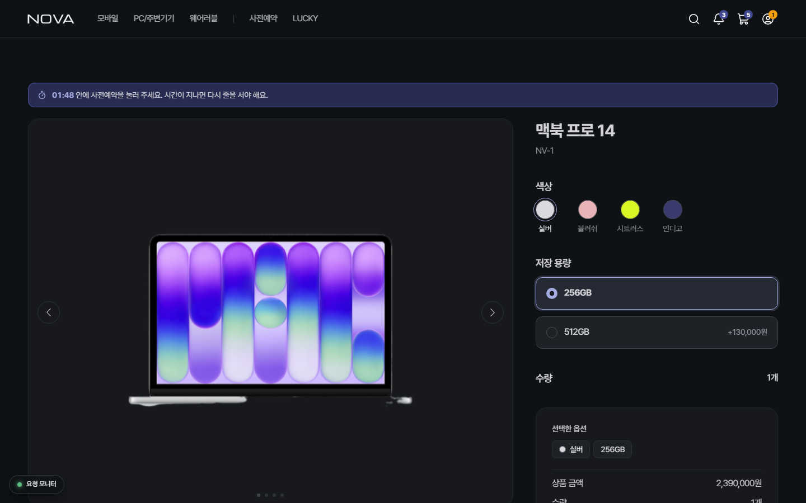</td>
    <td>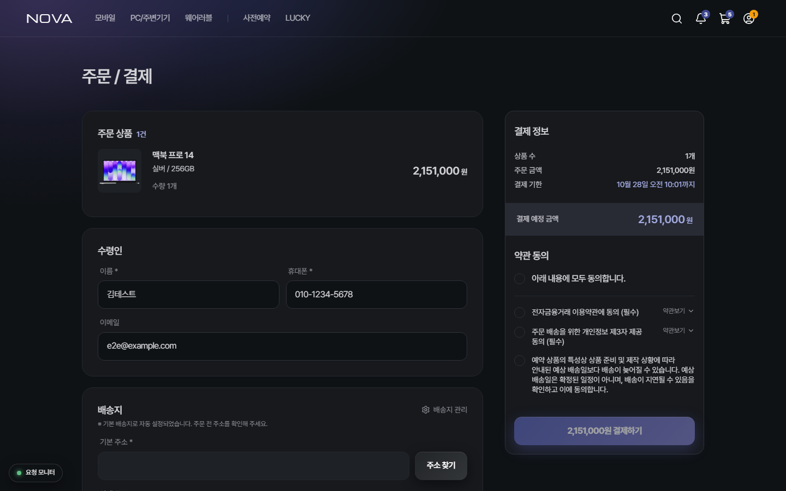</td>
  </tr>
  <tr>
    <td align="center"><b>상품 상세</b> · 입장권 유효 시간 안에 옵션을 골라 접수</td>
    <td align="center"><b>주문 / 결제</b> · 결제 기한 안내, 토스 결제창</td>
  </tr>
  <tr>
    <td>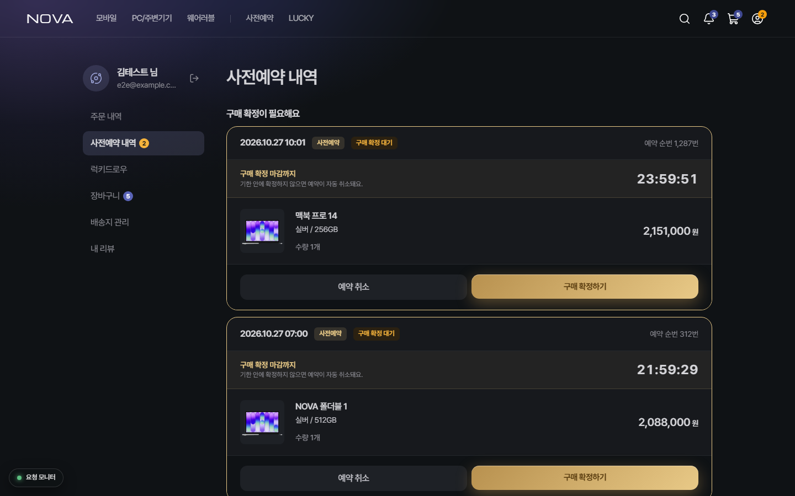</td>
    <td></td>
  </tr>
  <tr>
    <td align="center"><b>사전예약 내역</b> · 예약 순번과 구매 확정 마감 카운트다운</td>
    <td></td>
  </tr>
</table>

### 운영자 — 지금 상태를 보고, 멈춘 처리를 고친다

<table>
  <tr>
    <td width="50%">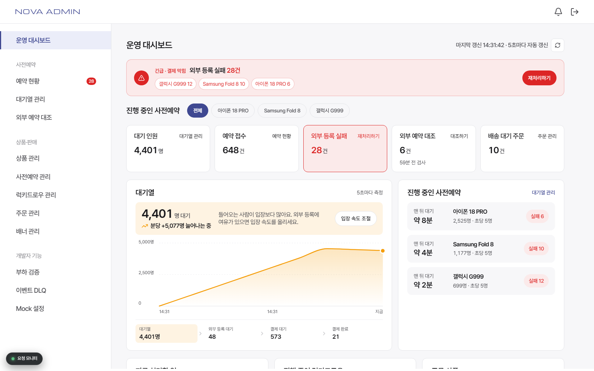</td>
    <td width="50%">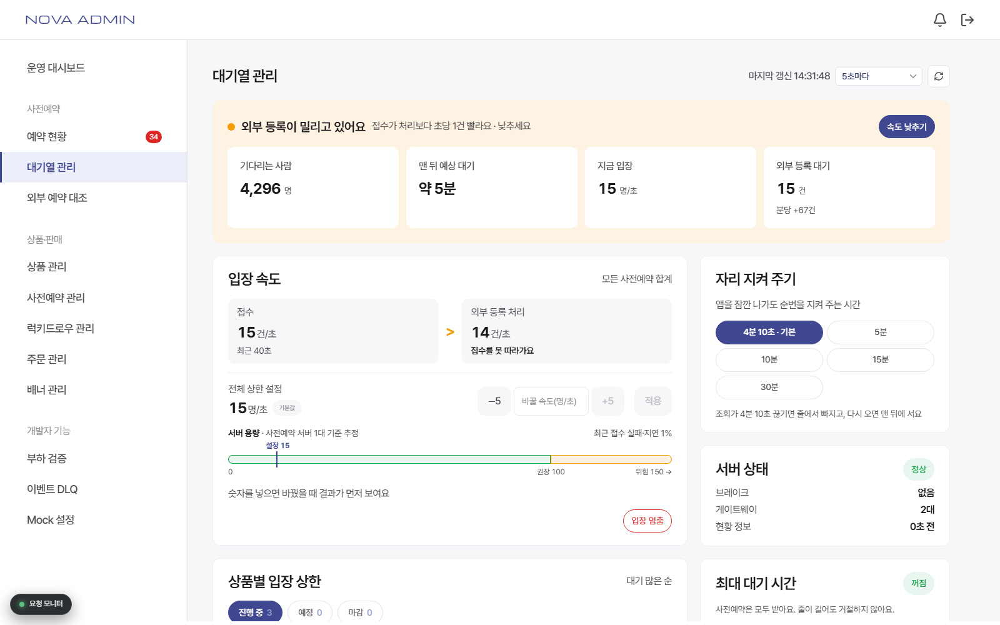</td>
  </tr>
  <tr>
    <td align="center"><b>운영 대시보드</b> · 긴급 할 일, 사전예약별 대기·실패, 대기열 추이</td>
    <td align="center"><b>대기열 관리</b> · 입장 속도·상품별 상한, 서버 용량과 밀림 판정</td>
  </tr>
  <tr>
    <td>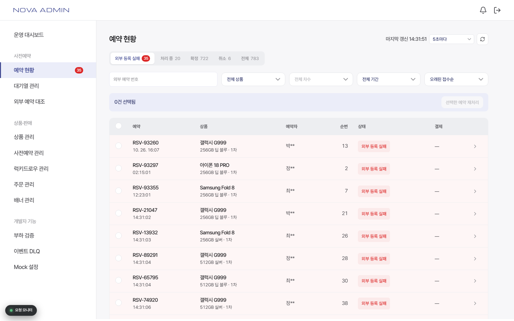</td>
    <td>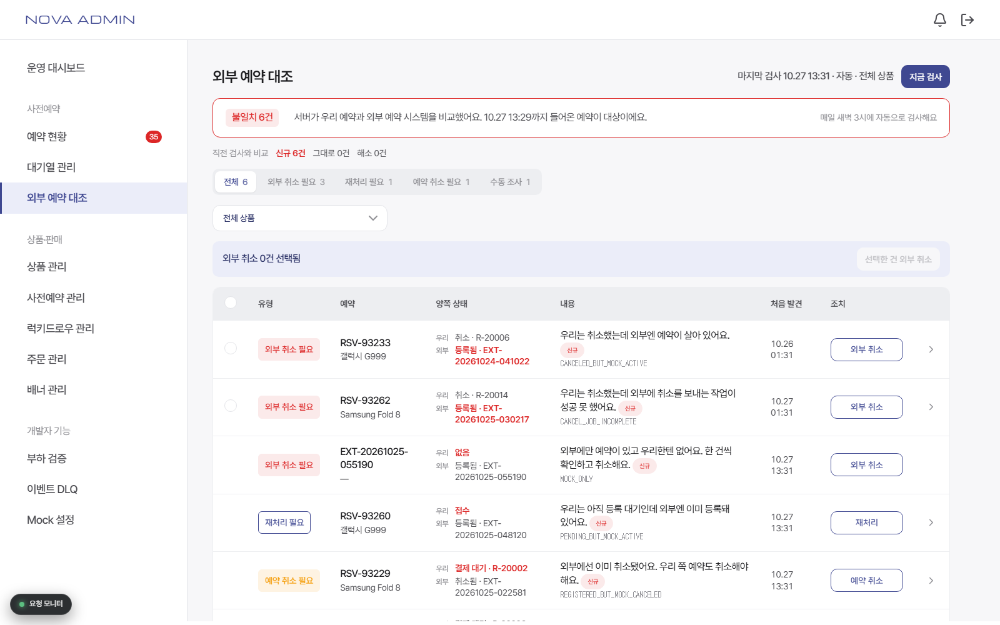</td>
  </tr>
  <tr>
    <td align="center"><b>예약 현황</b> · 단계별 탭, 재처리 필요 배지, 실패 예약 재처리 가능</td>
    <td align="center"><b>외부 예약 대조</b> · 서버 대조 결과, 직전 검사와 비교, 바로 조치</td>
  </tr>
  <tr>
    <td>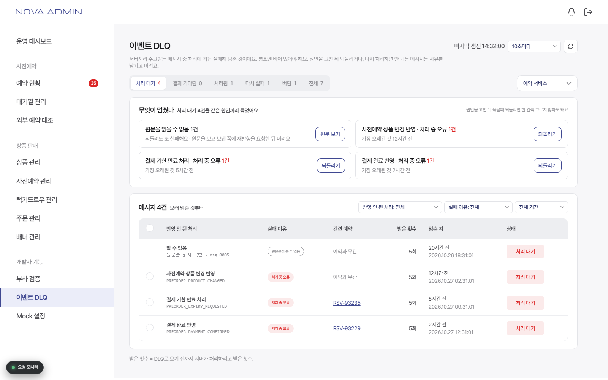</td>
    <td>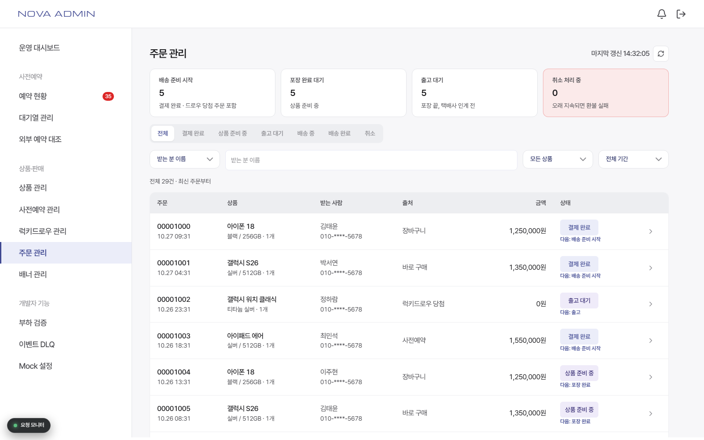</td>
  </tr>
  <tr>
    <td align="center"><b>이벤트 DLQ</b> · 예약·결제 서비스의 멈춘 메시지를 원인별로 되돌리기</td>
    <td align="center"><b>주문 관리</b> · 상태별 주문, 받는 분·전화 끝 4자리 검색, 배송 단계</td>
  </tr>
  <tr>
    <td>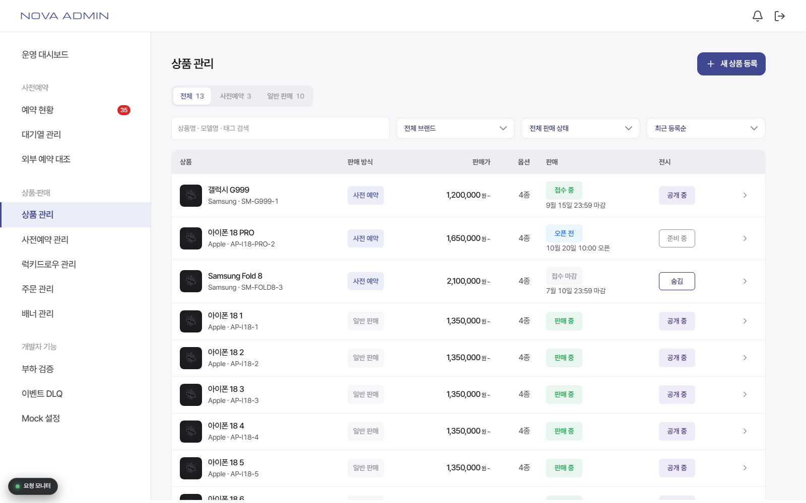</td>
    <td>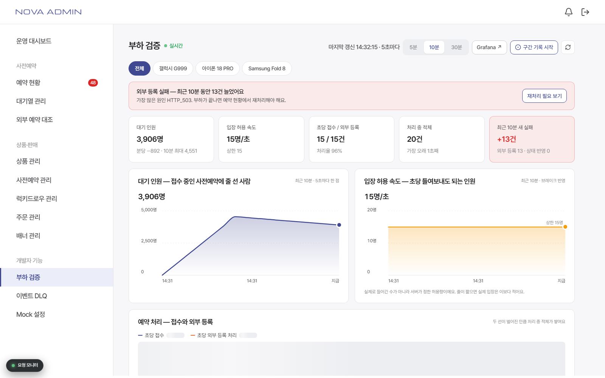</td>
  </tr>
  <tr>
    <td align="center"><b>상품 관리</b> · 등록·수정, 배송 구간, 오픈 뒤 잠금</td>
    <td align="center"><b>부하 검증</b> · 초당 접수·외부 등록과 구간 기록</td>
  </tr>
</table>

---

## ⚙️ 핵심 처리 흐름

```
대기열 입장 → 모델·옵션 선택 → 영속 접수(멱등키) → 순번 안내 → 백그라운드 외부 등록 → 구매 확정·결제 → 배송 차수 안내
```

> **접수 완료는 "신청을 안전하게 받았다"는 뜻입니다.** 외부 등록·구매·재고 확보가 끝났다는 뜻이 아닙니다.
> 그래서 화면도 처리 중과 확정을 다른 상태로 보여줍니다.

접수가 끊어 주는 **순번은 모델마다 1번부터** 독립적으로 부여되고, 오픈 전에 정해 둔 **배송 구간**(1차 1~1,000번, 2차 1,001번~ …)에 따라 배송 차수가 결정됩니다. 다른 모델의 신청 때문에 내 순번이 밀리지 않고, 외부 등록을 재처리해도 순번은 바뀌지 않습니다.

### 분리하면 생기는 세 가지 문제와 대응

| 문제       | 대응                                                                                                                                              |
| ---------- | ------------------------------------------------------------------------------------------------------------------------------------------------- |
| **유실**   | 처리 중 서버가 죽어도 재기동 후 **유실 없이 최종 결과에 도달**해야 하고, 그 과정에서 외부 등록이 중복돼서도 안 됨                                 |
| **중복**   | 입장권에서 만든 같은 멱등키로만 접수 — 다시 눌러도, 다른 탭에서 보내도 서버가 첫 결과를 돌려줌. 업무 규칙은 **모델별 1인 1매**                    |
| **불일치** | 확정했는데 외부에 없거나, 취소했는데 외부에 살아 있는 경우를 **서버가 매일 새벽 대조**하고, 운영자가 [외부 예약 대조] 화면에서 종류별로 바로 조치 |

### 일시 실패를 최종 실패로 취급하지 않습니다

**5%는 외부 호출의 실패율이지, 전체 예약의 5%를 최종 실패시키라는 뜻이 아닙니다.** 일시 실패는 자동 재시도로 복구하고, 재시도로도 안 되면 **재처리 필요**로 모아 운영자가 원인을 확인하고 다시 보냅니다. 서버끼리 주고받다 거듭 실패한 이벤트는 **이벤트 DLQ**에 쌓여 원인별로 되돌립니다.

그래서 UI에서 실패를 '확정 실패'가 아니라 '재처리 필요'로 부릅니다. 끝난 게 아니라 손이 필요한 상태라서요.

---

## ✨ 주요 기능

### 고객

- **대기열**: 서버가 정한 간격(Retry-After)으로만 순번을 묻고, 실패가 이어지면 2→4→8→16→30초로 늘려 다시 묻습니다. 새로 고치거나 창을 닫아도 같은 자리, 같은 키로 이어집니다.
- **멱등 접수**: 입장권을 SHA-256으로 바꾼 멱등키를 sessionStorage에 두어, 응답을 못 받아 다시 보내도 예약은 하나만 생깁니다.
- **처리 상태 조회**: 외부 등록이 5초 안에 끝나면 바로 결제로, 늦어지면 예약 접수 화면에서 지금 단계와 처리 기록을 보여 줍니다.
- **결제·취소**: 승인 응답이 늦어도 요청을 끊고 "결제 실패"로 단정하지 않습니다. 토스페이먼츠 결제창(개별 연동).

### 운영자

- **운영 대시보드**: 외부 등록 실패, 대조 불일치처럼 손댈 것을 먼저 보여 주고, 재처리 전에 실패 원인을 오류 코드별로 보여 줍니다.
- **대기열 관리**: 실제 입장 = min(운영값, 서버가 계산한 처리 용량) × 감속 배율. 외부 등록이 밀리거나 서버가 감속 중이면 속도를 올리지 못하게 막고, 바꾼 값은 이력으로 남깁니다.
- **예약 현황·상세**: 처리 중·확정·재처리 필요·취소 탭, 서버 정렬, 기간·회원별 보기, 처리 기록, 멈춘 외부 취소 다시 보내기·끝내기.
- **외부 예약 대조**: 서버 대조 검사 결과를 종류별로 보고 재처리·취소·외부 취소. 직전 검사와 비교해 새로 생긴 불일치부터 봅니다.
- **이벤트 DLQ**: 예약·결제 서비스의 멈춘 메시지를 같은 원인끼리 묶어 원래 큐로 되돌리거나, 사유를 남겨 버립니다.
- **상품·사전예약·럭키드로우·배너·주문 관리**: 배송 구간, 오픈 3분 전부터 잠금, 접수 다시 열기, 일반 상품 전환, 배송 단계.
- **부하 검증·Mock 설정**: 실서버 없이 장애를 재현하고 구간별로 숫자를 기록합니다.

---

## 👥 팀원 소개

<table>
  <thead>
    <tr>
      <th width="50%" align="center">김혜진</th>
      <th width="50%" align="center">이주현</th>
    </tr>
  </thead>
  <tbody>
    <tr>
      <td align="center"></td>
      <td align="center"></td>
    </tr>
    <tr>
      <td align="center"><a href="https://github.com/llmeajinll">@llmeajinll</a></td>
      <td align="center"><a href="https://github.com/hana03030">@hana03030</a></td>
    </tr>
    <tr>
      <td align="center">고객 화면 개발(메인, 사전예약, 대기열, 상품 상세, 결제, 마이페이지), 디자인 토큰·공용 UI, MSW 목 서버</td>
      <td align="center">운영자 백오피스 개발(운영 대시보드, 대기열 관리, 예약 현황, 외부 예약 대조, 이벤트 DLQ, 상품·사전예약·주문 관리, 부하 검증), 디자인 토큰·공용 UI, MSW 목 서버</td>
    </tr>
  </tbody>
</table>

---

## 🛠️ 기술 스택

| 분류          | 사용                                                                    |
| ------------- | ----------------------------------------------------------------------- |
| Frontend      | React 19, TypeScript 6, Vite 8                                          |
| Routing       | react-router v7 (`createBrowserRouter`)                                 |
| Styling       | Vanilla Extract + `@vanilla-extract/sprinkles` (zero-runtime CSS-in-TS) |
| Server State  | TanStack Query v5 (`queryPolicy` 프리셋, 폴링 백오프)                   |
| API Mocking   | MSW 2 (Service Worker)                                                  |
| Payment, Auth | 토스페이먼츠 SDK(결제창 개별 연동), 카카오 OAuth                        |
| Test          | Vitest(단위·스토리), Storybook 10, Playwright(E2E)                      |
| Monitoring    | Grafana Faro(실사용자 모니터링), Amplitude(사용 분석)                   |
| Quality       | ESLint(FSD import 규칙), Prettier, husky + lint-staged, commitlint      |
| Deploy        | Vercel (`/api/*` → `api.grandis-nova.link`로 rewrite)                   |

---

## 💻 실행 방법

**1. 사전 요구사항** — Node.js `v20.19.0` 이상 또는 `v22.12.0` 이상, npm `v10.x`

**2. 설치**

```bash
git clone https://github.com/Grandis-2/fe.git
cd fe
npm install
```

**3. 환경 변수** — 루트에 `.env.local`을 만듭니다(`*.local`은 커밋되지 않습니다). 항목 설명은 [`.env.example`](.env.example)에 있습니다.

```bash
VITE_KAKAO_OAUTH_REST_API_KEY=   # 카카오 REST API 키
VITE_TOSS_PAYMENTS_CLIENT_KEY=   # 토스 "API 개별 연동" 테스트 클라이언트 키(test_ck_...)
VITE_USE_MSW=                    # 비우면 dev는 목, 배포는 실서버. 로컬에서 실서버에 붙으려면 false
```

**4. 실행**

```bash
npm run dev     # http://localhost:5173
```

- 목으로 띄우면 백엔드 없이 모든 화면이 동작합니다. **관리자 목 계정**: `admin` / `admin1234`
- 주소에 `?mockScenario=open`을 붙여 열면 오픈 상황(사전예약 3개에 5,000명, 외부 등록 5% 실패)을 흉내 냅니다.

---

## 📜 스크립트

```bash
npm run dev          # Vite 개발 서버
npm run build        # tsc -b && vite build
npm run analyze      # 번들 크기 트리맵(dist/stats.html)
npm run lint         # eslint .
npm run format:fix   # prettier --write .
npm run storybook    # Storybook (:6006)
npm run test         # Vitest 단위 테스트 (src/**/*.test.ts)
npm run e2e          # Playwright E2E — MSW를 켠 개발 서버를 :5174에 따로 띄운다
npx vitest --project storybook   # 스토리 play 테스트 (실제 Chromium)
```

처음 테스트를 돌릴 땐 `npx playwright install chromium`이 필요할 수 있습니다.

---

## 🧪 테스트와 검증

| 종류          | 무엇을                                                                                           | 규모         |
| ------------- | ------------------------------------------------------------------------------------------------ | ------------ |
| 단위 테스트   | 돈·재시도가 걸린 순수 로직(결제 승인, 대기열 백오프, 밀림 판정, 페이지 이어 받기 등)             | 37개 파일    |
| 스토리 테스트 | 컴포넌트 상태별 화면(로딩·빈·에러·장애)을 `play` 함수로 확인                                     | 스토리 190개 |
| E2E           | 대기열·접수·결제·여러 창·서버 오류, 관리자 예약 현황·외부 예약 대조·결제 DLQ를 브라우저로 끝까지 | 12개 파일    |
| 목 서버       | 실패 확률·응답 지연·느린 꼬리를 화면(Mock 설정)에서 걸어 장애 화면을 재현                        | —            |

E2E는 `.env.local`과 무관하게 목으로 돌고, 토스 결제창·다음 우편번호는 가짜로 바꿉니다. 테스트마다 새 브라우저라 목 DB가 시드에서 시작합니다.

---

## 🧩 아키텍처

### Feature-Sliced Design

```
src/app → pages → widgets → features → entities → shared
```

위 레이어는 아래를 import할 수 있고 **그 반대는 안 됩니다.** `eslint.config.js`의 `import-x/no-restricted-paths`가 강제합니다.

| 레이어     | 역할                                                              |
| ---------- | ----------------------------------------------------------------- |
| `app`      | 라우터, 레이아웃, 전역 스타일, QueryClient                        |
| `pages`    | 라우트 하나에 대응하는 조립 (`pages/admin/*`은 관리자)            |
| `widgets`  | 큰 조립물 (헤더, 대기열 관리, 외부 예약 대조 — `widgets/admin/*`) |
| `features` | 사용자 행동 단위 (로그인, 대기열, 결제, 상품 구매)                |
| `entities` | 도메인 모델 + 조회 함수 + TanStack Query 훅                       |
| `shared`   | 공용 UI, 디자인 토큰, fetch 래퍼, DTO, MSW                        |

### 데이터 레이어

**서버 응답 모양(DTO)이 UI까지 새지 않게 해서, API가 바뀌어도 고칠 곳이 `entities/*/api` 하나로 끝나게 합니다.**

```
서버 JSON → shared/api → entities/*/api → entities/*/model → ui
             (DTO, fetch)   (DTO→모델)      (도메인 타입)
```

- 모든 API 실패는 `apiClient`에서 `ApiRequestError`(`code`·`message`·`status`)로 정규화됩니다.
- 조회는 TanStack Query 훅으로만 하고, 프리셋(`catalog`·`account`·`live`)을 씁니다. 폴링은 실패하면 간격을 늘려 다시 묻습니다.
- 변경(mutation)은 자동 재시도하지 않습니다. 같은 요청이 두 번 반영될 수 있어서입니다. 예외는 멱등키가 있는 사전예약 접수뿐입니다.
- "0건"과 "조회 실패"를 구분합니다. 실패를 빈 목록이나 0으로 보이지 않게 합니다.

### 스타일

디자인 토큰은 `src/shared/config/theme/tokens/`(`color`·`typography`·`spacing`·`breakpoint`·`motion`·`shadow`)에 있고, 항상 배럴(`@shared/config/theme`)에서 가져옵니다. 반응형은 mobile-first `sprinkles()`, 기준은 `desktop = (min-width: 744px)`입니다.

---

## 📁 폴더 구조

```
src/
├─ app/                 # 라우터, 레이아웃(RootLayout → MainLayout / AdminLayout), 전역 스타일
├─ pages/               # 라우트 하나 = 파일 하나
│  ├─ main/  preorder/  product-detail/  payment/  mypage/ …
│  └─ admin/            # home/ waitingroom/ reservations/ reconciliation/ dead-letters/ …
├─ widgets/
│  ├─ header/  banner/  mobile-tab-bar/ …
│  └─ admin/            # ops-home/ waitingroom/ reservation-reconcile/ dead-letters/ …
├─ features/            # login/ preorder-queue/ payment/ product-purchase/ …
├─ entities/            # product/ preorder/ order/ admin-reservation/ admin-reconciliation/ …
│  └─ <name>/
│     ├─ api/           # 조회 함수 + Query 훅 + DTO→모델 매퍼
│     ├─ model/         # 도메인 타입·상수
│     ├─ lib/           # 훅·순수 로직
│     ├─ ui/<Comp>/     # Comp.tsx · .css.ts · .stories.tsx · index.ts
│     └─ index.ts       # 배럴 — 밖에서 들어오는 문
└─ shared/
   ├─ api/              # client.ts, queryPolicy.ts, types/(DTO), mock/(MSW 핸들러·시드)
   ├─ config/           # routes.ts, theme/
   ├─ lib/  model/
   └─ ui/               # 공용 컴포넌트 61종
```

---

## 🗺️ 라우트

### 고객

| 경로                                       | 화면                             |
| ------------------------------------------ | -------------------------------- |
| `/`                                        | 메인                             |
| `/preorder`, `/preorder/:preorderId`       | 사전예약 목록·상세               |
| `/products/:productId`                     | 상품 상세(옵션 선택, 접수)       |
| `/draws`, `/draws/:drawId`                 | 럭키드로우                       |
| `/payment`, `/payment/callback`, `/result` | 결제, 결제 콜백, 결과            |
| `/mypage?state=`                           | 주문·사전예약·럭키드로우 내역 등 |
| `/search`, `/reviews`, `/signup`           | 검색, 후기, 가입                 |

### 관리자 (`/admin/login`으로 로그인)

| 경로                                       | 화면                                  |
| ------------------------------------------ | ------------------------------------- |
| `/admin`                                   | 운영 대시보드                         |
| `/admin/waitingroom`                       | 대기열 관리                           |
| `/admin/reservations` · `/:preorderId`     | 예약 현황 · 예약 상세                 |
| `/admin/reconciliation`                    | 외부 예약 대조                        |
| `/admin/dead-letters` · `/:deadLetterId`   | 이벤트 DLQ(`?service=payment`면 결제) |
| `/admin/products` · `/new` · `/:id`        | 상품 관리(옵션·재고·배송 구간)        |
| `/admin/preorders` · `/new` · `/:id`       | 사전예약 관리                         |
| `/admin/draws` · `/new` · `/:id`           | 럭키드로우 관리                       |
| `/admin/banners` · `/new` · `/:id`         | 배너 관리                             |
| `/admin/orders` · `/:orderId`              | 주문 관리                             |
| `/admin/load-test`, `/admin/mock-settings` | 부하 검증, Mock 설정(개발자 기능)     |

경로 문자열은 [`src/shared/config/routes.ts`](src/shared/config/routes.ts)에 모여 있습니다.

---

## ✍️ 커밋 컨벤션

`commitlint` + `husky`로 강제합니다. 본문은 한국어로 씁니다.

```
feat: 이벤트 DLQ에 결제 서비스 추가(서비스 선택 + 주소 분기)
fix: 예약 잘못 보내는 부분 수정
```

- 타입: `feat` `fix` `refactor` `style` `docs` `design` `chore` `test`
- `pre-commit`에서 `lint-staged`가 바뀐 파일만 `eslint --fix` + `prettier --write`로 돌립니다.

---

## 📚 더 읽을 것

- [`CLAUDE.md`](CLAUDE.md) — 아키텍처 규칙과 실제로 겪은 함정 모음.
- [`.claude/rules/`](.claude/rules/) — 경로별 상세 규칙(스타일, 데이터 레이어, 라우팅, JSX).
- [`e2e/persona-scenarios.md`](e2e/persona-scenarios.md) — E2E가 따라가는 고객·운영자 시나리오.
- [`openwiki/`](openwiki/) — 자동 생성되는 코드 인덱스. 손으로 고치지 않습니다.
